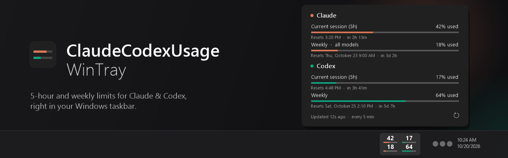

<h1 align="center">
  
</h1>

<p align="center">
  <a href="README.md"></a>
  <a href="README.ko.md"></a>
</p>

<p align="center">
  Your Claude and Codex usage limits, right in the Windows taskbar.
</p>

<p align="center">
  <a href="https://github.com/haengseon/ClaudeCodexUsageWinTray/releases/latest"></a>
  
  <a href="LICENSE"></a>
</p>

I kept typing `/usage` just to see how much of my 5-hour window was left. This puts those numbers next to the clock so I don't have to.

## What you get

```
  42    17     ← current 5-hour session (% used)
 ▬▬──  ▬───
  18    64     ← weekly limit (% used)
 ▬───  ▬▬▬─
Claude Codex
```

- Small columns sit just left of the notification area. Orange is Claude, green is Codex. You only get a column for what you're signed in to, and a new one appears on its own after you sign in.
- Click them to see what `/usage` would tell you: every limit, when it resets, and how long until then. There's a refresh button at the bottom if you want fresh numbers right away.
- It checks every 5 minutes by default. Right-click to pick anything from 1 to 60 minutes, see whether each one is signed in, turn on start with Windows, or quit.
- A gauge turns red once you pass 80%.
- Menus follow your Windows display language (English or Korean), and dates and times follow your region format.

There's nothing to configure. It reads the sign-in that Claude Code and Codex already saved on your PC, and it only calls their usage endpoints. No prompts are sent, so checking doesn't cost you any of your limits.

## Install

You'll need Windows 10 or 11. It works with the command-line tools or the desktop apps, so any of these is enough: Claude Code CLI or the Claude app, Codex CLI or the Codex app. One of them is fine too, and if none is set up yet it still runs and shows you how to sign in.

1. Grab `ClaudeCodexUsageWinTray.exe` from [Releases](https://github.com/haengseon/ClaudeCodexUsageWinTray/releases/latest).
2. Put it in any folder and run it. There's no installer.
3. The numbers show up next to the clock after a few seconds.

To have it start with Windows, right-click the numbers and turn on **Start with Windows**. It updates itself when a new release comes out.

## What it accesses

It runs as your normal user. No admin rights, no telemetry, and nothing is sent anywhere except the addresses below.

| What | When and why |
| --- | --- |
| `%USERPROFILE%\.claude\.credentials.json` | Reads your Claude sign-in. If the token has expired and Claude hasn't renewed it, it renews it and saves it back to the same file, the way Claude Code does. |
| `%USERPROFILE%\.codex\auth.json` | Same for Codex. |
| `api.anthropic.com`, `platform.claude.com`, `console.anthropic.com` | Claude usage (every 5 minutes by default) and token renewal |
| `chatgpt.com`, `auth.openai.com` | Codex usage (every 5 minutes by default) and token renewal |
| `api.github.com`, `github.com` | Checks for a new release once a day and swaps the exe in place |
| `HKCU\Software\Microsoft\Windows\CurrentVersion\Run` | Only when you turn on start with Windows |
| `HKCU\Software\ClaudeCodexUsageWinTray` | Only when you change the refresh interval |
| `claude auth login`, `codex login`, the Claude or Codex app | Only when you click a sign-in item. It uses the CLI if you have it, otherwise the app, otherwise it opens the download page. |

If you've set `CLAUDE_CONFIG_DIR` or `CODEX_HOME`, it looks there instead, same as the CLIs.

## FAQ

<details>
<summary><b>I only see a column of dashes</b></summary>
<br>
Nothing is signed in yet. Right-click and pick a sign-in item. It opens the CLI login, or the app if you don't use the CLI.
</details>

<details>
<summary><b>The numbers look faded</b></summary>
<br>
The last check didn't go through (no network, or the service asked to slow down), so you're looking at the last values it got. It retries on its own. Click to see the reason.
</details>

<details>
<summary><b>Windows says it protected my PC</b></summary>
<br>
The exe isn't code-signed yet, so SmartScreen warns on first run. Click <b>More info</b> and then <b>Run anyway</b>.
</details>

<details>
<summary><b>Nothing shows up in the taskbar</b></summary>
<br>
A vertical taskbar (left or right edge on Windows 10) isn't supported. Otherwise check that the app is still running in Task Manager.
</details>

<details>
<summary><b>How do I remove it?</b></summary>
<br>
Right-click, turn off <b>Start with Windows</b>, pick <b>Quit</b>, then delete the exe. If you changed the refresh interval, you can also delete <code>HKCU\Software\ClaudeCodexUsageWinTray</code>.
</details>

## License

[MIT](LICENSE)
